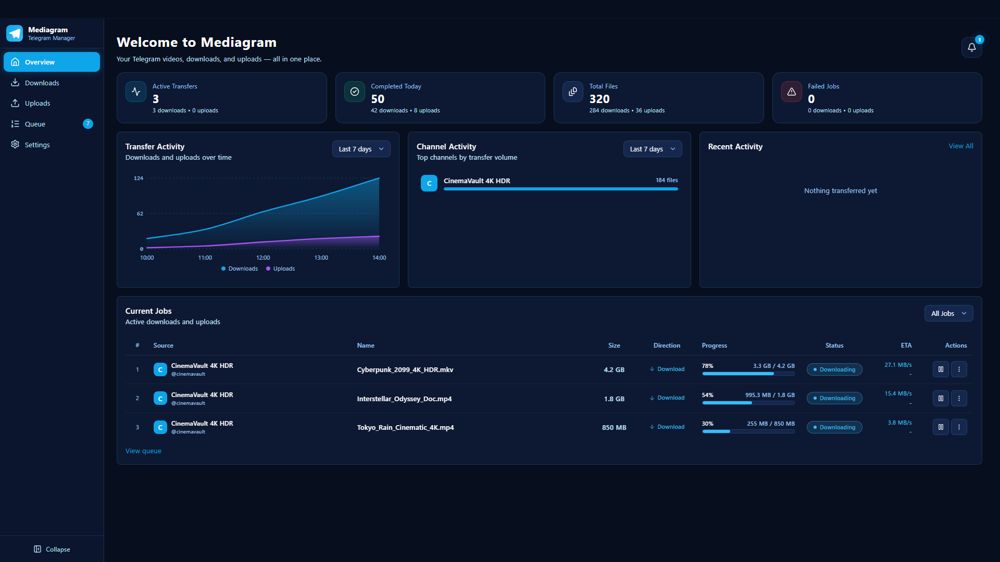
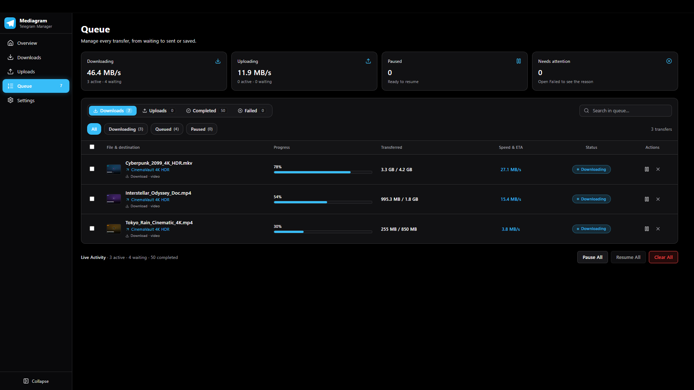
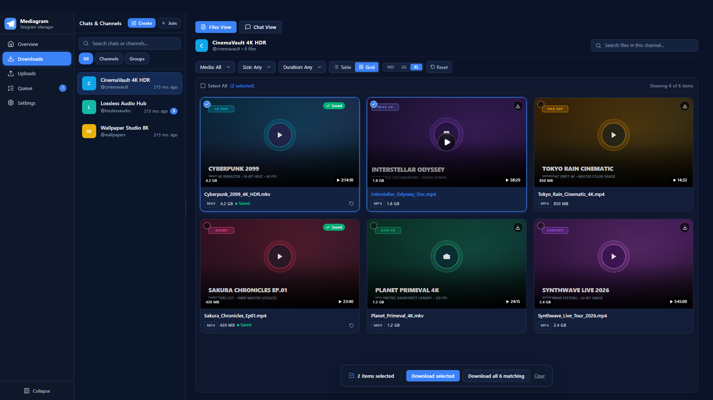
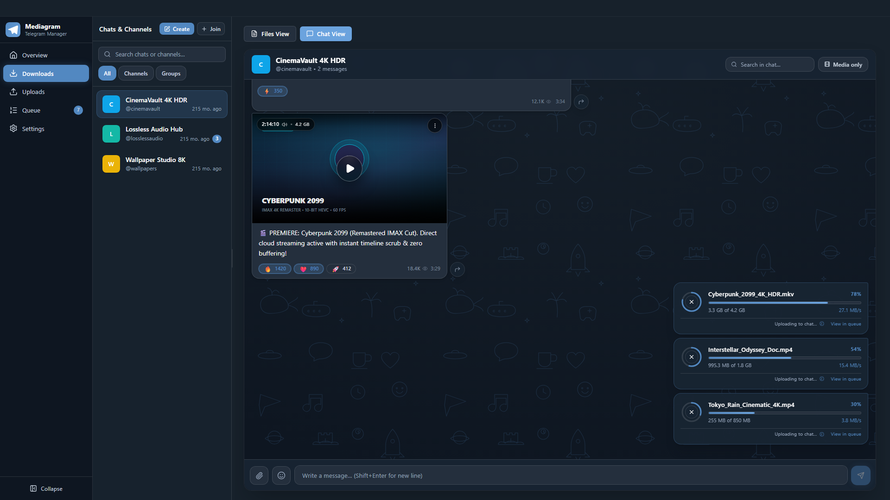
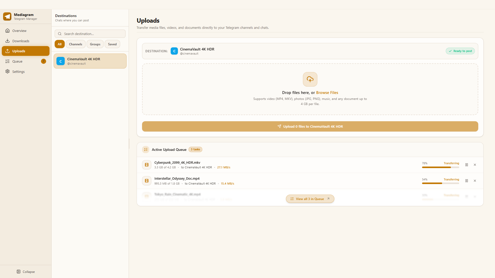
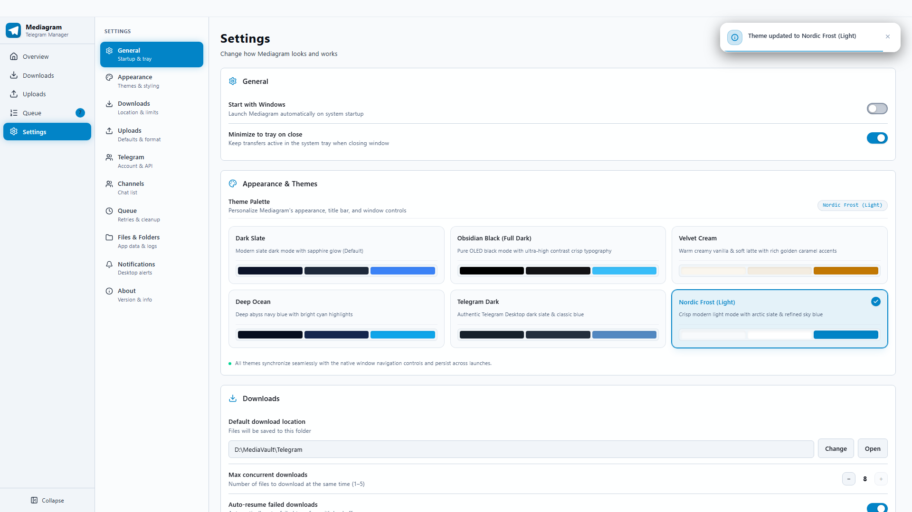
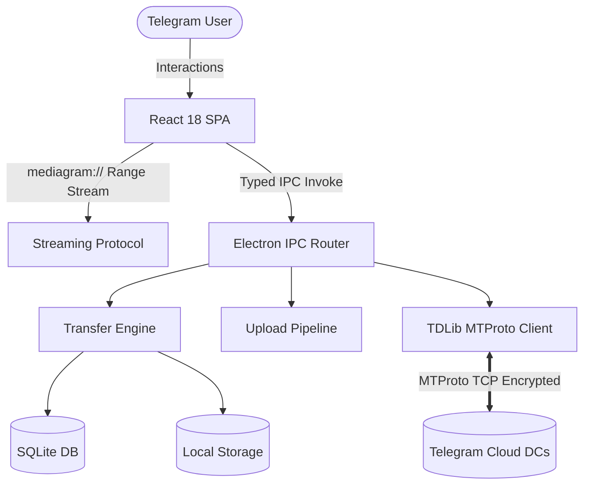

<div align="center">

<p align="center">
  
</p>

# Mediagram

### A fast desktop Telegram media downloader with instant video streaming

<p align="center">
  <b>Multi-stream downloads, instant playback of large video files, and direct MTProto transfer management.</b>
  <br />
  <i>Built with Electron, React 18, SQLite, and the official Telegram Database Library (TDLib).</i>
</p>

<p align="center">
  
  
  
  
  
  
  
  
</p>

<p align="center">
  🚀 <b>Fast Multi-Stream Downloads</b> &nbsp;|&nbsp;
  ⚡ <b>Instant Video Streaming</b> &nbsp;|&nbsp;
  🛡️ <b>Sandboxed & Private</b>
</p>

<p align="center">
  <a href="#core-features"><b>Features</b></a> •
  <a href="#showcase"><b>Screenshots</b></a> •
  <a href="#quick-start"><b>Quick Start</b></a> •
  <a href="#how-it-works"><b>How It Works</b></a> •
  <a href="#architecture"><b>Architecture</b></a> •
  <a href="#project-structure"><b>Project Structure</b></a> •
  <a href="#development"><b>Development</b></a> •
  <a href="#faq"><b>FAQ</b></a> •
  <a href="#license"><b>License</b></a>
</p>

</div>

---

> [!IMPORTANT]
> **Mediagram** runs entirely on your Windows machine and connects directly to Telegram's datacenters over MTProto. There are no proxy servers, tracking cookies, or third-party servers between your device and Telegram.

<div align="center">

https://github.com/user-attachments/assets/9997ea5c-0dd0-4673-988b-d543f02f9140

<p><i>Feature showcase: multi-stream downloading, instant video streaming, and media management (🔊 Unmute in player for audio)</i></p>
</div>

---

<a id="core-features"></a>
## ⚡ Core Features

<table>
  <tr>
    <td width="50%" valign="top">
      <h3>🚀 Multi-Stream Downloader</h3>
      <p>A high-concurrency download engine built to make full use of your connection. Includes automatic flood-wait backoff, stall prevention, and priority reordering.</p>
    </td>
    <td width="50%" valign="top">
      <h3>🎬 Instant Video Streaming</h3>
      <p>Click any large video file and it starts playing right away in the built-in player. Mediagram fetches the video header and tail chunks in the background, so you don't have to wait for the whole file to download.</p>
    </td>
  </tr>
  <tr>
    <td width="50%" valign="top">
      <h3>🗂️ Telegram-Style Media Gallery</h3>
      <p>Browse media in a compact <b>Table</b> or a <b>Grid</b> view (Medium, Large, Extra Large). Select multiple files with desktop-style <b>marquee drag selection</b>.</p>
    </td>
    <td width="50%" valign="top">
      <h3>📂 Smart Folder Automation</h3>
      <p>Keep downloads organized automatically. Configurable templates such as <code>{chat}</code>, <code>{chat_id}</code>, and dates sort files into dedicated folders.</p>
    </td>
  </tr>
  <tr>
    <td width="50%" valign="top">
      <h3>🛡️ Sandboxed Security & Privacy</h3>
      <p>Built with Electron isolation. Local files are streamed only through a privileged <code>mediagram://</code> protocol, and session encryption keys are stored in your device's local keychain.</p>
    </td>
    <td width="50%" valign="top">
      <h3>📢 Channel & Supergroup Studio</h3>
      <p>Create public or private channels and supergroups from inside the app, with live username availability checks, permission switches, slow-mode controls, and join-request settings.</p>
    </td>
  </tr>
</table>

---

<a id="showcase"></a>
## 📸 Screenshots & Themes

Mediagram includes six themes. Click any screenshot to open it in full resolution.

<details open>
<summary><b>Expand / collapse screenshot gallery</b></summary>
<br />

### 1. Overview Dashboard & Download Queue

<table width="100%">
  <tr>
    <th width="50%" align="center">📊 Overview Dashboard — <i>Deep Ocean</i></th>
    <th width="50%" align="center">⚡ Download Queue — <i>Obsidian Black</i></th>
  </tr>
  <tr>
    <td>
      <a href="assets/screenshots/01-overview-deep-ocean.png" target="_blank">
        
      </a>
    </td>
    <td>
      <a href="assets/screenshots/04-queue-obsidian-black.png" target="_blank">
        
      </a>
    </td>
  </tr>
  <tr>
    <td align="center"><i>Bandwidth activity curve, completed tasks, and top channels</i></td>
    <td align="center"><i>Active multi-part chunk downloads running at 46.4 MB/s</i></td>
  </tr>
</table>

<br />

### 2. Media Vault & Direct Cloud Streaming

<table width="100%">
  <tr>
    <th width="50%" align="center">🎬 Media Vault — <i>Dark Slate</i></th>
    <th width="50%" align="center">💬 Chat View & Video Player — <i>Telegram Dark</i></th>
  </tr>
  <tr>
    <td>
      <a href="assets/screenshots/02-downloads-dark-slate.png" target="_blank">
        
      </a>
    </td>
    <td>
      <a href="assets/screenshots/03-chat-telegram-dark.png" target="_blank">
        
      </a>
    </td>
  </tr>
  <tr>
    <td align="center"><i>Media grid with batch multi-selection bar</i></td>
    <td align="center"><i>Direct cloud streaming in chat, with reactions and lossless audio</i></td>
  </tr>
</table>

<br />

### 3. Uploads Studio & Settings

<table width="100%">
  <tr>
    <th width="50%" align="center">📤 Uploads Studio — <i>Velvet Cream</i></th>
    <th width="50%" align="center">⚙️ Appearance & Settings — <i>Nordic Frost</i></th>
  </tr>
  <tr>
    <td>
      <a href="assets/screenshots/05-uploads-velvet-cream.png" target="_blank">
        
      </a>
    </td>
    <td>
      <a href="assets/screenshots/06-settings-nordic-frost.png" target="_blank">
        
      </a>
    </td>
  </tr>
  <tr>
    <td align="center"><i>Multi-file staging dropzone and destination channel picker</i></td>
    <td align="center"><i>Available themes: <b>Dark Slate</b>, <b>Obsidian Black</b>, <b>Velvet Cream</b>, <b>Deep Ocean</b>, <b>Telegram Dark</b>, <b>Nordic Frost</b></i></td>
  </tr>
</table>

</details>

---

<a id="quick-start"></a>
## 🚀 Quick Start

**Requirements:** Windows 10 or 11 (x64) and a Telegram account.

1. **Download the installer**
   Get the latest `Mediagram-Setup-1.0.0.exe` from the [Releases](https://github.com/Webovignesh/Mediagram/releases) page.
2. **Run setup**
   Install Mediagram. No administrator privileges are required.
3. **Sign in**
   * Enter your phone number.
   * Provide your Telegram `API_ID` and `API_HASH`. You can get both in about a minute from [my.telegram.org](https://my.telegram.org).
   * Enter your Telegram verification code and your two-step verification password, if enabled.
4. **Start downloading**
   Your chats, channels, and media load right after sign-in.

---

<a id="how-it-works"></a>
## 🧠 How It Works

Mediagram is built from three layers:

1. **Core engine (`core/`)**
   Runs the official C++ **TDLib** library through prebuilt bindings and negotiates MTProto v2 encrypted sessions directly with Telegram's servers. An embedded **SQLite** database stores download history, file hashes, and queue priorities.
2. **Desktop shell (`electron/`)**
   Enforces a strict Content Security Policy (CSP). The React UI runs in a sandboxed Chromium renderer with no direct Node.js access, and all requests go through typed IPC bridges with path authorization.
3. **Video streamer (`mediagram://`)**
   A custom protocol that handles byte-range requests for video. It prefetches the `moov` atom at the end of the file and serves chunks to Chromium's native media player before the full file is saved to disk.

---

<a id="architecture"></a>
## 🏛️ System Architecture

Explore the interactive architecture diagram:
👉 **[Open the interactive architecture page](https://htmlpreview.github.io/?https://github.com/Webovignesh/Mediagram/blob/main/.archify/mediagram_architecture.html)** (or open the local file [`.archify/mediagram_architecture.html`](.archify/mediagram_architecture.html) in any browser).



---

<a id="project-structure"></a>
## 📂 Project Structure

```text
Mediagram/
├── core/                      Engine (Node.js & TDLib)
│   ├── db.ts                  SQLite database (downloads, settings, history)
│   ├── shapes.ts              Shared types (Chat, Media, Message)
│   ├── storage.ts             File paths, folder sanitization, disk management
│   ├── telegram.ts            TDLib connection (MTProto encryption)
│   ├── transfers.ts           Download engine (speed limits, auto-retry, stall prevention)
│   └── uploads.ts             Upload pipeline (album batching, chunked sender)
│
├── electron/                  Desktop shell & security bridge
│   ├── main.ts                Main process (app window, tray, menus)
│   ├── preload.ts             Secure bridge between UI and main process
│   ├── ipc.ts                 IPC router (maps UI actions to core functions)
│   ├── mediaStream.ts         Safe media file reading from disk
│   ├── mediaRange.ts          Range streaming (instant seeking and playback)
│   └── updater.ts             OTA update controller (auto-updater & cache sweep)
│
├── web/                       React UI
│   ├── src/
│   │   ├── pages/
│   │   │   ├── Downloads.tsx  Main hub (chat sidebar, media filters, grid & table views)
│   │   │   ├── ChatView.tsx   Telegram-style chat (messages, reactions, composer)
│   │   │   ├── Queue.tsx      Live transfer manager (pause, resume, reorder)
│   │   │   ├── Uploads.tsx    Drag-and-drop batch uploads
│   │   │   ├── Overview.tsx   Stats dashboard, storage gauges, notifications
│   │   │   └── Settings.tsx   Themes, download folder, duplicate checker
│   │   ├── ui.tsx             Reusable components (video player, dialogs, buttons)
│   │   ├── api.ts             React hooks for backend calls
│   │   └── styles.css         Tailwind CSS and animations
│   └── index.html             Single-page app root
│
├── assets/                    Branding & installer resources
│   ├── icon.ico / icon.png    App logo and system tray icon
│   └── installer.nsh          NSIS installer customization script
│
├── tests/                     Automated test suite
│   └── *.test.ts              Unit tests (database, security, networking, updater)
│
└── Config files
    ├── package.json           Scripts, project info, dependencies
    ├── electron.vite.config   Vite bundler config for Electron
    └── tsconfig.json          Strict TypeScript compiler settings
```

---

<a id="development"></a>
## 🛠️ Development

### Prerequisites

* Windows 10 or 11 (x64)
* [Node.js](https://nodejs.org/) v24 or later
* npm v10 or later

### Setup & Running Locally

```powershell
# 1. Clone the repository
git clone https://github.com/Webovignesh/Mediagram.git
cd Mediagram

# 2. Install dependencies
npm ci

# 3. Start the development server with hot module reloading
npm run dev

# 4. Run type checks and unit tests
npm run typecheck
npm test

# 5. Build the production installer (.exe)
npm run dist
```

---

<a id="faq"></a>
## ❓ FAQ

<details>
  <summary><b>Is Mediagram safe to use?</b></summary>
  <p>Mediagram is open source and uses Telegram's official client library (TDLib). Your credentials and session files are stored locally on your device and are never sent to any third party.</p>
</details>

<details>
  <summary><b>Can I play a large video while it's still downloading?</b></summary>
  <p>Yes. Mediagram's streaming protocol fetches the beginning and end of the video container (the <code>moov</code> atom) first, so playback can start immediately, even for multi-gigabyte files.</p>
</details>

<details>
  <summary><b>Where are downloaded files saved?</b></summary>
  <p>By default, files are saved to <code>%USERPROFILE%\Downloads\Mediagram</code>. You can change this at any time in <b>Settings</b>.</p>
</details>

<details>
  <summary><b>How do duplicate checks work?</b></summary>
  <p>Before queueing a transfer, Mediagram compares local file paths and exact byte sizes. If the file is already downloaded, it is marked as <code>Saved</code> and skipped.</p>
</details>

---

<a id="license"></a>
## 📜 License

This project is licensed under the **MIT License**. See the [LICENSE](LICENSE) file for details.

<div align="center">
  <sub>Built with ❤️ by <a href="https://github.com/Webovignesh">Webovignesh</a> and contributors.</sub>
</div>
